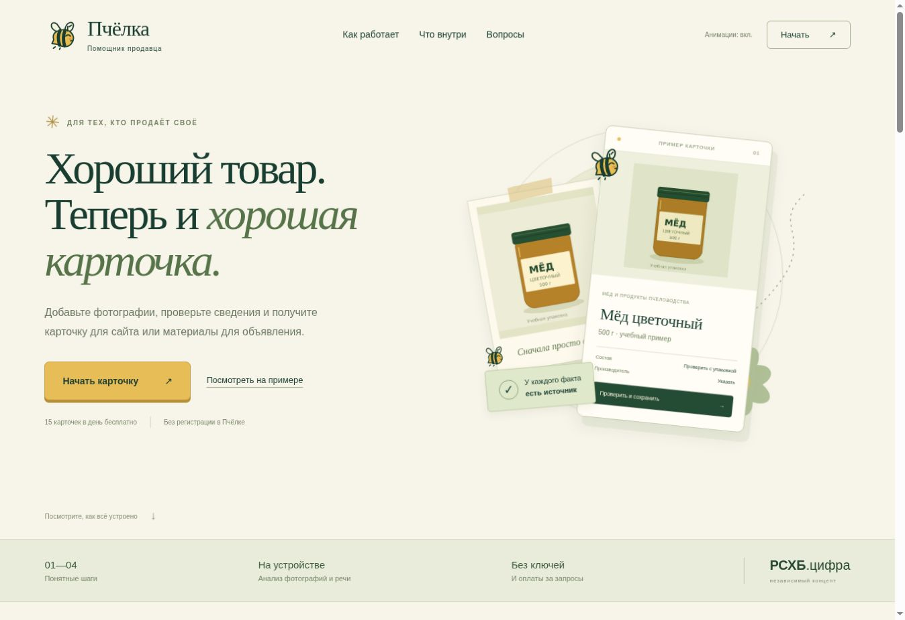

# Пчёлка

Пошаговый сервис подготовки карточек товаров. Концепт для РСХБ.цифра: фотографии → подтверждение сведений → описание и оформление → готовый HTML для сайта.

**Быстрый запуск на Windows:** распакуйте архив целиком, откройте папку `pchelka`, дважды нажмите `start.bat`. Нужен установленный Python 3.10 или новее. Оставьте окно открытым и перейдите на **http://localhost:8000**.

Платные ключи ИИ, `.env`, Docker и установка npm-пакетов для этого способа не нужны.



## Запустить другим способом

| Способ | Команда из папки проекта | Что установить |
|---|---|---|
| Python | `python server.py` (Windows: `py -3 server.py`) | Python 3.10+; проверено на 3.12 |
| macOS / Linux | `sh start.sh` | Python 3.10+ |
| Docker | `docker compose up --build -d` | Docker с Compose |

Везде адрес один: http://localhost:8000. Python остановить сочетанием Ctrl+C; контейнер — `docker compose down`.

`requirements.txt` намеренно не содержит пакетов: сервер использует стандартную библиотеку Python. При желании `python -m pip install -r requirements.txt` ничего дополнительно не устанавливает. Не устанавливайте пакеты с похожими названиями по случайным инструкциям.

## Что работает

- Главная страница, обучение при первом входе и четыре шага с подсказками.
- MobileCLIP-S0: локальная классификация фотографии среди 34 типов товаров, несколько вариантов и оценка сходства. Это не OCR и не вероятность достоверности состава.
- Поиск в Open Food Facts по GTIN или названию, источник и ручное подтверждение совпадения упаковки.
- Qwen2.5-0.5B-Instruct через WebLLM: написать, продолжить или улучшить описание по данным товара и своему пожеланию.
- Vosk: русская речь с микрофона или аудиофайла, редактирование транскрипта и подтверждение полей.
- Редактор фотографии, название, описание, цвет, цена и ссылка. Оценка готовности и предварительная проверка.
- HTML-карточка без JavaScript, витрина, QR-код на ссылку, ценники A4.
- Каталог в браузере, варианты товара, профиль продавца, резервная копия, выбор одного / нескольких / всех товаров.
- Тексты и фото для Авито, Юлы и VK; общий пост VK. Размещение и изменение объявления выполняет пользователь на площадке.

## Устройства, модели и интернет

| Компонент | Что входит в архив | Условия работы |
|---|---|---|
| MobileCLIP + ONNX Runtime | Модель частями и runtime, около 57 МБ | Современный браузер с WASM; фотографии обрабатываются локально |
| Vosk RU | Речевая модель частями около 46 МБ, runtime | Микрофон: HTTPS/localhost и разрешение. Можно выбрать аудиофайл |
| Qwen + WebLLM | Runtime, WASM и конфигурация | Веса около 300 МБ загружаются отдельно с Hugging Face при первом включении; WebGPU, около 1 ГБ GPU-памяти |
| Open Food Facts | Веса не нужны | Интернет для запроса по названию/штрихкоду |

Вручную заполнять, редактировать и экспортировать карточки можно без генератора текста. Первая загрузка и работа на слабом устройстве могут занять больше времени. «Три минуты» — цель повторного сценария, не измеренное обещание.

## Где хранятся данные

Фото, черновики и каталог хранятся в браузере этого домена. Поиск передаёт серверу только запрос: название или штрихкод. Текст генерации и аудио не отправляются в облачную нейросеть. Загрузка публичных весов Qwen использует внешнее хранилище.

Скачивайте резервную копию через «Мои товары». Очистка браузера, приватный режим или переход на другой домен могут лишить доступа к локальному каталогу. Фото и данные в экспортированных файлах доступны получателю файла.

Лимит **15 новых карточек в сутки** хранится в браузере, сбрасывается по московской дате и не защищён от очистки/изменения часов. Правки и повторный экспорт его не расходуют.

## Вставить результат на сайт

1. Заполнить сведения и проверить фотографию и текст.
2. Подтвердить готовую карточку.
3. Нажать «Скопировать карточку для сайта».
4. Вставить в HTML-блок редактора сайта или скачать готовый HTML-файл.

Фото и стили уже внутри. CMS может удалять data URI или inline-стили: тогда фото нужно загрузить в её медиатеку. Корзина, оплата, остатки и оформление заказа в карточку не входят. [Контракт и примеры](docs/INTEGRATION.md).

## Разработчику

Основной переносимый запуск — `server.py` или Docker. Он обслуживает весь `public/` и `GET /api/products`.

Также сохранён исходный контур Vinext / Cloudflare: `app/`, `worker/`, `components/`, `lib/`, `scripts/`, `package.json`, `pnpm-lock.yaml`, `.openai/hosting.json`. Это отдельный вариант разработки и хостинга с инфраструктурой Sites, а не требование для запуска Python. [Подробнее о размещении](docs/DEPLOYMENT.md). Не удаляйте эти файлы, если нужен полный исходный проект.

Проверки без npm install:

```sh
python -m unittest discover -s tests -p "test_*.py" -v
node tests/test_engine.mjs
node tests/test_workbench.mjs
node tests/test_plus.mjs
python scripts/verify-release.py
```

Для JS-тестов нужен Node.js 22+. Они не требуют установки зависимостей. Workflow GitHub Actions запускает эти проверки и проверку Docker-образа после загрузки репозитория.

## Документация

- [Загрузить на GitHub](docs/GITHUB.md) — Desktop и команды Git.
- [Размещение и Docker](docs/DEPLOYMENT.md), [эксплуатация и резервные копии](docs/RUNBOOK.md).
- [Интеграция](docs/INTEGRATION.md), [OpenAPI](public/api-contract.json), [пример HTML](examples/integration/README.md).
- [Архитектура](docs/ARCHITECTURE.md), [продукт](docs/PRODUCT.md), [показ решения](docs/DEMO.md).
- [Безопасность](docs/SECURITY.md), [сообщить об уязвимости](SECURITY.md).
- [Зависимости и лицензии](docs/THIRD_PARTY.md), [лицензия собственного кода](LICENSE.md).
- [Проверки этой поставки](docs/VALIDATION.md), [история](CHANGELOG.md), [участие](CONTRIBUTING.md).
- [Презентация PDF](docs/presentation/Pchelka_Reshenie.pdf) и [PowerPoint](docs/presentation/Pchelka_Reshenie.pptx).

## Границы прототипа

Нет серверной базы карточек, командных ролей, синхронизации устройств, официальной модерации и автоматической публикации на площадки. Неизвестные факты нужно уточнять у продавца. Поиск ограничен Open Food Facts и может не найти товар. Генерация может ошибаться, предпроверка неполна, окончательное подтверждение обязательно.

Это концепт для РСХБ.цифра, а не заявление об официальном внедрении или сертификации банка. GitHub хранит исходники; создание репозитория само по себе не запускает сайт для посетителей.
